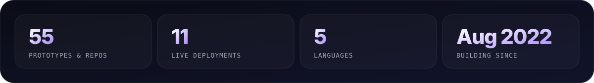
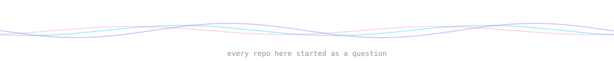

  

I work on AI product strategy. When an idea looks worth it, I build a version people can click instead of writing a deck about it. Those prototypes live here: some are live, some are open source, and a few stay private while I work on them.

### Featured prototypes

<!-- cards:start -->

<!-- cards:end -->

### How I work

  

### Recently shipped

<!-- recent:start -->
- `15 Oct` &nbsp; [**high-signal-dashboard**](https://github.com/kriai/high-signal-dashboard)
- `03 Sep` &nbsp; [**nova-hub**](https://github.com/kriai/nova-hub)
- `22 Jul` &nbsp; [**equity-research-journal**](https://github.com/kriai/equity-research-journal) · Personal equity-research journal - searchable notes on companies I've studied. Astro + Netlify
- `10 Jun` &nbsp; [**ai-crm**](https://github.com/kriai/ai-crm)
- `21 May` &nbsp; [**nova-demo**](https://github.com/kriai/nova-demo) · [↗ demo](https://quebec-topaz.vercel.app)
<!-- recent:end -->

  
   
  Regenerated by a GitHub Action · last refreshed <!-- updated -->17 Oct 2026<!-- /updated -->

  

